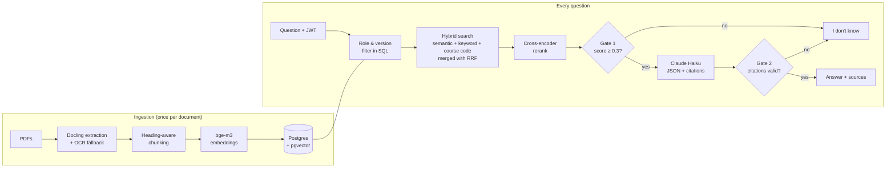
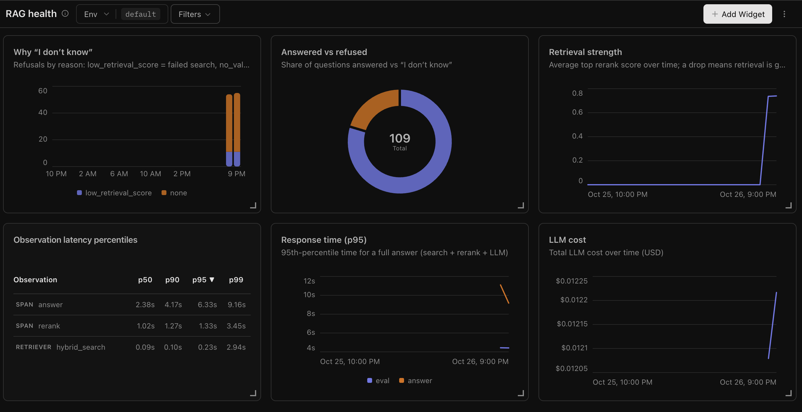

# academic-knowledge-rag

A production-grade RAG assistant that answers questions about Jönköping University course syllabi and academic policies, covering **all 778 English-taught courses and 61 English-taught programmes (2024–2026)**. **Every answer cites its source document and page**, users only see documents their role allows, outdated syllabus versions are never used by mistake, and when the documents don't contain the answer it says **"I don't know"** instead of guessing.

**Live demo:** https://academic-knowledge-rag-vkuqfq2bwaznayuodq474y.streamlit.app/  
**API docs:** https://academic-knowledge-rag.onrender.com/docs

| Demo account | Password | Sees |
| --- | --- | --- |
| `student@ju.test` | `password` | Public syllabi and policies |
| `professor@ju.test` | `password` | The above + staff-only guidelines |

> Free hosting: the first request after a quiet period can take up to a minute while the server wakes up.

### Questions to try

| Question | Shows |
| --- | --- |
| *Can I take Machine Learning (TMLS22) if my major is Computer Science?* | Uses the **current** syllabus (2025 added Computer Science; 2024 didn't) |
| *What did the 2024 TARI29 syllabus say about grading?* | Naming a year retrieves the old version, with a warning |
| *What share of points do examiners require for grade 5?* | Student: "I don't know". Professor: 85% (staff-only document) |
| *What is the best pizza place in Jönköping?* | "I don't know" without calling the LLM |
| *How many re-exam attempts do I get?* | No course named, so it says which courses the rule comes from and that others may differ |
| *I started the AI Engineering master's in autumn 2024. How many first-year credits do I need to start year 2?* | Programme rules apply per start year: 30 credits from the 2024 syllabus, not 37.5 from the current one |

---

## How it works



1. **Ingestion:** 1,296 documents (1,096 course syllabi, 184 programme syllabi, 12 policies, 4 synthetic staff documents) are extracted with Docling, keeping page numbers and headings. Scanned pages fall back to OCR. Text is split under its headings into 14,102 chunks (tables too long for the embedding model are split by rows, repeating the header), each prefixed with course, year and section before embedding. A harvester collects every English-taught course and programme syllabus from JU's catalogues, politely (one request per second) and resumably, skipping duplicates by SHA-256.
2. **Hybrid search:** semantic search (pgvector), Postgres full-text search and a course-code match each return 20 candidates; Reciprocal Rank Fusion merges them.
3. **Reranking:** a cross-encoder (`bge-reranker-v2-m3`) rescores the candidates by reading question and passage together; the top 5 go to the LLM.
4. **Two gates against hallucination:** if the best passage scores below 0.3, the LLM is never called. If the LLM's answer has no valid citation, it's replaced with "I don't know". Citations are checked in code, not trusted from the prompt.

## Production features

| Feature | How |
| --- | --- |
| **Role-based access control** | FastAPI + bcrypt passwords + JWT tokens. The user's role becomes a filter **inside the SQL query**, so restricted documents are never even searched. |
| **Outdated-document handling** | Syllabus versions are grouped by course; older versions get `superseded_by` and are excluded in SQL unless the question names a year. The prompt includes today's date. |
| **Evaluation** | 58-question test set (course facts, policies, exact references, versions, permission pairs, unanswerable, ambiguous, programme cohorts) scored on hit@5, answer/refuse decision, citation correctness, outdated citations, leaks, and whether ambiguous answers name their source course. |
| **Cohort-aware programme answers** | A programme syllabus applies to students who start in its term, so a student who names their start year gets that version, with a warning that later cohorts follow a newer one. |
| **Robust LLM output** | The JSON reply is parsed up to the first complete object, and an unparseable reply is retried once before falling back to "I don't know". |
| **Course-scoped answers** | A syllabus states rules for one course, so when a question names no course, the answer says which course(s) a rule comes from and that others may differ. |
| **Tracing & monitoring** | Langfuse traces every request (search → rerank → LLM with tokens and cost) and scores each outcome; a dashboard tracks refusals by reason, latency per step and cost. |
| **Local or API models** | `MODEL_BACKEND=local\|api`: the same models run on the laptop or via API, so the deployed backend needs 83 MB of memory instead of 4–5 GB. |

## Results

**Fixing outdated answers (Stage 7).** The first full evaluation showed the LLM citing old syllabus versions despite a prompt instruction to prefer the newest. Moving the rule into SQL fixed it:

| Metric | Before | After |
| --- | --- | --- |
| Answer/refuse decision | 98.1% | **100%** |
| Cited an expected document | 97.6% | **100%** |
| Cited an outdated version | 15 | **0** |
| Restricted documents leaked | 0 | 0 |

**Moving to API models without changing answers.** API embeddings matched the stored local vectors (cosine 0.9999), rerank scores differed by at most 0.008, and the full evaluation was re-run in each setup:

| Setup | API tests | Evaluation | Seconds / question |
| --- | --- | --- | --- |
| Local database + local models | 9/9 | 100% | 2.5 |
| Local database + API models | 9/9 | 100% | 3.6 |
| **Neon + API models (production)** | **9/9** | **100%** | **4.4** |

**Scaling from 37 to 1,112 documents.** Thirty times more documents means many more near-miss passages. The first run showed two new failure types, both caused by the bigger knowledge base: a general question became ambiguous (many courses now have a final project), and a formerly unanswerable question ("How many re-exam attempts do I get?") now matched one course's syllabus, which the system presented as a general rule. A prompt rule and an updated test set fixed both:

| Run | Documents | hit@5 | Decision | Citation | Ambiguous answers naming their course |
| --- | --- | --- | --- | --- | --- |
| Before scaling | 37 | 100% | 100% | 100% | – |
| After scaling, first run | 1,112 | 97.6% | 98.1% | 97.6% | – |
| **After the fix** | **1,112** | **100%** | **100%** | **100%** | **2/2** |
| + programme syllabi, first run | 1,296 | 100% | 98.3% | 100% | 2/2 |
| **+ JSON parsing fix** | **1,296** | **100%** | **100%** | **100%** | **2/2** |

The test set was drafted from the documents' own wording, so these scores are an upper bound; questions phrased the way students actually ask are the next step.

**Monitoring dashboard (Langfuse):**



## Tech stack

| Layer | Tools |
| --- | --- |
| Extraction | Docling (layout models, OCR fallback) |
| Storage & search | Postgres 16, pgvector (HNSW), Postgres full-text search |
| Models | `BAAI/bge-m3` embeddings, `BAAI/bge-reranker-v2-m3` reranker (local via sentence-transformers, or Novita API), Claude Haiku 5.5 |
| Backend | FastAPI, Pydantic, PyJWT, bcrypt |
| Frontend | Streamlit |
| Evaluation & tracing | Custom evaluation suite, pytest, Langfuse |
| Deployment | Render (backend), Neon (database), Streamlit Community Cloud (frontend) |

## Project structure

```
app/            FastAPI backend: retrieval, rerank, generation, auth, models, tracing
ingestion/      harvest → extract → chunk → load → embed → versions; schema, seeding, copy to Neon
eval/           test set, evaluation and backend-comparison scripts, saved results
frontend/       Streamlit app
tests/          API and access-control tests
data/           manifest.csv (PDFs themselves are not committed)
```

## Run it locally

Requires Python 3.14 and Docker.

```bash
docker compose up -d                                   # Postgres + pgvector
python -m venv .venv && source .venv/bin/activate
pip install -r requirements.txt
cp .env.example .env                                   # then fill in your keys

# build the knowledge base: download the PDFs listed in data/manifest.csv (~1 hour)
python ingestion/harvest_courses.py
python ingestion/extract.py && python ingestion/chunk.py
docker exec -i akr-db psql -U akr -d akr < ingestion/schema.sql
python ingestion/load.py && python ingestion/embed.py && python ingestion/versions.py
python ingestion/seed_users.py

uvicorn main:app --app-dir app                         # backend: http://127.0.0.1:8000/docs
streamlit run frontend/app.py                          # frontend: http://localhost:8501

python -m pytest tests -v                              # access-control tests
python eval/run_eval.py                                # 58-question evaluation
```

## Deployment

| Part | Service | Notes |
| --- | --- | --- |
| Backend | Render (free, Frankfurt) | `requirements-server.txt` (13 packages, no torch); `MODEL_BACKEND=api` |
| Database | Neon (free, EU) | Copied from local with `ingestion/copy_to_neon.py`, vectors included; 212 MB of the free 1 GB |
| Frontend | Streamlit Community Cloud | `API_URL` secret points to the backend |

**Running cost:** about $0.50/month at 1,000 questions (LLM ≈ $0.0004 per question; embeddings and reranking a few cents). An always-on backend instead of the sleeping free tier would add about $7/month.

## Limitations

- **Cold starts** on the free tier (up to about a minute after inactivity).
- **Single-turn:** each question is answered on its own, without conversation memory.
- **Test set wording:** questions were drafted from the documents, so real-world phrasing may perform worse.
- **Staff documents are synthetic,** written to test access control; they are not real JU documents.
- **English-taught only:** the ~1,200 Swedish-taught courses per year (Swedish syllabi) are not included yet.
- **Partly Swedish sources:** some regulations are bilingual; answers are always in English.
- **11 syllabi lack a parsed `valid_from` date** (7 course syllabi whose header is a table, 4 programme syllabi with no start term); a year-based fallback still orders their versions correctly.
- **No rate limiting** on the public demo yet; costs are capped by provider spend limits instead.

## Data

Syllabi and policies are public documents from [ju.se](https://ju.se); `data/manifest.csv` lists each document's source URL. The PDFs are not stored in this repository. The four `synthetic_*` documents are fictional and clearly labelled as such.
